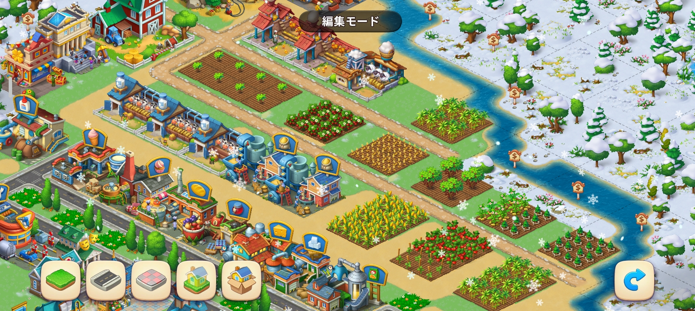
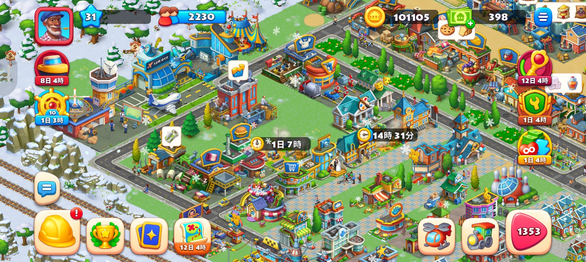

# Township 都市開発プロジェクト

**移転による成長ではなく、増設による成長。**

市長と都市計画局による、Townshipの街づくり・都市計画・整備記録を公開しています。

## 都市計画を読む

- [都市基本計画](master-plan.md) — 地区ごとの土地利用と整備原則
- [都市開発履歴](development-history.md) — Sprint単位の整備記録
- [都市開発プロジェクトの運営](operation.md) — 市長と都市計画局の役割、記録のルール

## 都市開発日誌

- [2026年11月21日の記録](episodes/2026-11-21.md)
- [2026年11月22日：農業地区の景観](episodes/2026-11-22-agricultural-landscape.md)

## 地区ギャラリー

### 農業地区の景観

### 食品加工地区の現況調査（2026年11月22日）

[食品加工地区の調査写真（全9枚）をGitHubで見る](https://github.com/togawa0428/township-urban-development/tree/main/images/districts)

## 開発課題

- [GitHub Issues（未完了・完了を含む）](https://github.com/togawa0428/township-urban-development/issues?q=is%3Aissue)
- [食品加工地区の現況調査・完了報告（Issue #2）](https://github.com/togawa0428/township-urban-development/issues/2)

---

このサイトはゲーム内の街づくりを記録するファンプロジェクトです。公式のTownship運営サイトではありません。
